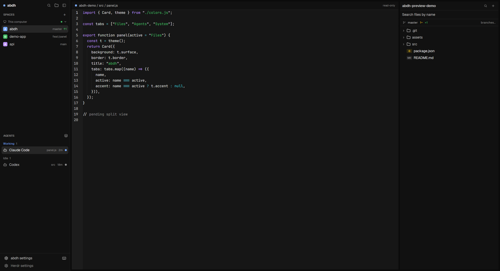

# abdh — a Carbon Herdr layout

A compact, Carbon-inspired Herdr workspace: a left rail for spaces and agents, an icon-tabbed panel on the right (Files, Agents, System), an editor with diff and blame, git branch/merge actions, and a bottom file/git status bar.



*Screenshot uses a demo project, not a personal workspace.*

Built for [Herdr](https://herdr.dev) 0.1.12. Tested on Windows 11; the system probes also have Linux and macOS paths, tinted by the current theme.

## Install

### One command

Windows (PowerShell):

```powershell
powershell -NoProfile -Command "irm https://raw.githubusercontent.com/abdh01h/herdr-abdh-theme/main/install.ps1 | iex"
```

macOS / Linux:

```sh
curl -fsSL https://raw.githubusercontent.com/abdh01h/herdr-abdh-theme/main/install.sh | sh
```

The installer downloads this repository, backs up every file or folder it replaces
(`*.bak-<timestamp>`), installs the theme, layout and mods into the Herdr home,
merges the editor keys while keeping any chord you already use, runs
`herdr-app check` on each `abdh-*` mod, and switches to the layout when a window
is running.

Options: `-HerdrHome <path>` / `HERDR_APP_HOME`, `-Branch <name>` / `BRANCH`,
`-NoLayout` / `NO_LAYOUT=1`. On Linux/macOS the key merge needs `python3` or
`node`; without either, add the `mod:abdh-editor` block from
`keys.snippet.json` by hand.

### Install with an agent

Point any coding agent at the repository and say:

> Install the abdh Herdr theme from https://github.com/abdh01h/herdr-abdh-theme —
> read `AGENT_INSTALL.md` and do it end to end, then switch the layout and show
> me the check/status output.

The repo ships the brief (`AGENT_INSTALL.md`), a root `AGENTS.md`, and a
Claude Code skill at `.claude/skills/abdh-install/SKILL.md`. With the repository
as the working project, “install abdh” is enough. To make the skill available
from any project, copy that folder to `~/.claude/skills/` (the installer does
not do this automatically).

### Manual

Herdr reads `~/.config/herdr-app` (`$HERDR_APP_HOME` overrides it). Back it up first.

1. `themes/abdh.json` → `~/.config/herdr-app/themes/`
2. `layouts/abdh.json`, `layouts/abdh.svg` → `~/.config/herdr-app/layouts/`
3. every `mods/abdh-*` folder → `~/.config/herdr-app/mods/`
4. merge `keys.snippet.json` into `~/.config/herdr-app/keys.json`
5. `herdr-app check ~/.config/herdr-app/mods/abdh-<name>` for each folder, then
   `herdr-app do layout.switch --name abdh`

Models and settings live in `~/.config/herdr-app/abdh-settings.json`, written by `abdh-settings` (open it from the sidebar footer → **abdh settings**).

## What you get

| Part | Behavior |
|---|---|
| Left rail | Spaces (machines, worktrees, drag reorder, right-click menus) + agent list, both restyled but behavior-compatible |
| Top-right icons | Files / Agents / System panel tabs + Git (branches, history, checkout, create, merge) beside the window buttons |
| Files (right panel) | Real tree, file-type badges, git status colors, create/rename/delete/copy/paste, context menu, name + content search (git grep / ripgrep) |
| Editor (mod pane) | Edit and save files, dirty state, external-change reload/overwrite, file tabs, **Diff** (HEAD → buffer), **Blame** (whole file), unsaved-change prompts |
| Status bar | Folder, branch, ahead/behind, change counts; file language, lines, chars, words, EOL, encoding, save key |
| Agents panel | Real agent/token analytics from agent session logs, totals by agent/session/model, history charts |
| System panel | Real CPU/RAM/GPU/storage/network/battery via OS probes, traffic-light meters, configurable intervals |
| Settings | `abdh-settings.json`: appearance, tabs, explorer, agents, system, status bar, git; paged theme picker |

## Keys

Added under `mod:abdh-editor` (active while an editor pane has focus):

```json
"mod:abdh-editor": {
  "ctrl-s": "abdh-editor.save",
  "cmd-s": "abdh-editor.save",
  "ctrl-w": "abdh-editor.close",
  "cmd-w": "abdh-editor.close",
  "ctrl-shift-s": "abdh-editor.saveas",
  "cmd-shift-s": "abdh-editor.saveas"
}
```

The editor also has **Diff**, **Blame**, **Save** and a pane-close button. `abdh-editor.diff` and `abdh-editor.close` are also callable as commands.

## Requirements and limits

- **Search:** content search uses `git grep` inside repos (single-threaded); elsewhere ripgrep, capped to two threads and depth 12. At the home folder content search is intentionally off. Name search needs nothing extra.
- **Temperature:** real CPU core temps need [LibreHardwareMonitor](https://github.com/LibreHardwareMonitor/LibreHardwareMonitor) running (read from its WMI namespace). Without it the card says `temp unavailable`; Windows ACPI thermal zones are not shown as CPU temp.
- **Blame** is whole-file, not per-line: `EditorState` exposes no cursor position.
- **Diff** is a separate read-only view, not an inline gutter: the editor API exposes no decorations.
- Remote (ssh machine) files open read-only in the editor.
- Pane dragging is disabled (`"movable": false`) so the top-center grip never covers content.
- Herdr's own Settings → Look draws one card per theme file; this repo ships a paged theme picker in **abdh settings → Themes** instead.
- `abdh-spaces` and `abdh-agents-list` are derived from Herdr's Apache-2.0 `spaces`/`agents` mods; the token scanner in `abdh-agents` is derived from the `insights` mod. See `NOTICE`.

## Layout files

- `layouts/abdh.json` — the window tree (left rail, work area, right panel, status bar), theme `abdh`, no pane headers, `movable: false`.
- `themes/abdh.json` — Carbon palette with `selection` and component colors.
- `.claude/skills/abdh-theme/SKILL.md` — an agent skill for installing, verifying and modifying this theme.

## License

Apache-2.0. See `LICENSE` and `NOTICE`.
