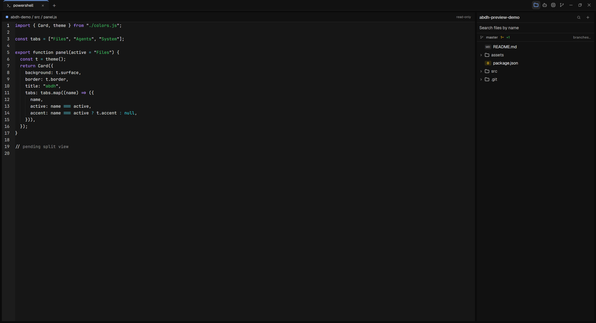

# abdh

A compact Carbon-dark Herdr workspace: spaces and agents on the left, an icon-tabbed Files/Agents/System panel on the right, an editor with diff and blame, git branch tools, and a file/git status bar.

## What you see

- **Left rail, 256 px** (`min 44`, `max 420`), background `chrome` (#111111): a 40 px brand bar (`abdh` wordmark, search, panel toggle, sidebar toggle), then `SPACES` (28 px header; machine groups, colored 16 px avatars, active space on `raised` with a 2 px accent bar), then `AGENTS` (28 px header; group headers, 28 px agent rows with program icon, name, time, pin, status), then a 66 px footer (`abdh settings`, keyboard-shortcut icon, Herdr settings).
- **Work area**: a 32 px app tab strip (Chrome-like: 30 px tabs, rounded top, 2 px accent top edge on the active tab, 28 px ghost `+` after the last tab), the active tab's panes (6 px gap, 8 px radius, 1 px border, 1 px focus), and a 24 px status bar.
- **Right panel, 360 px** (`min 260`, `max 760`, `chrome`): the selected tool only — Files, Agents or System — with no inner header; the switcher lives in the window bar.
- **Window bar, top right**: Files, Agents, System and Git icons immediately left of the window buttons. Active tool on `raised` with an accent icon; clicking the active one hides the panel.
- **Status bar**: folder, branch, ahead/behind, modified/new/deleted/staged/conflicted counts on the left; active file name, language, lines, chars, words, EOL, encoding and the save chord on the right.

Type: JetBrains Mono 13 for terminals/editor, Geist for chrome. Palette: background #161616, chrome #111111, surface #1c1c1c, raised #262626, border #2b2b2b, foreground #f4f4f4, accent #78a9ff, done #42be65, blocked #fa4d56, ansi0–15 Carbon-tuned.

## How it behaves

- Spaces: click to switch, right-click for the Herdr space menu, drag a row onto another to reorder, machine headers fold; connected machines with no spaces keep their header but do not add an empty “New space there” row.
- Agents: click to focus the pane, hover shows pin and elapsed time, group headers fold, sub-agents fold under their parent, the sort button opens the grouped/priority menu.
- Panel icons: select/show the tool; the active icon toggles the panel closed; Git opens the branch overlay: Branches (checkout, merge), History (the last 150 commits with short hash, subject, author, relative time, refs), New branch (create from any source), Merge (conflict reporting); blame when opened for a file.
- Files: click a folder to expand, a file to open it in the editor pane; right-click for Open, Rename, Copy, Cut, Paste, Git blame, Reveal, Delete (confirm); `Delete` and `F2` work on the selected row; `Ctrl/Cmd+C/X/V` copy, cut and paste on disk. Search: names (git index / bounded scan) and contents (`git grep` in repos, ripgrep elsewhere), 450 ms debounce, snippets with line numbers, paged to 200 results.
- Editor: real writes; `Ctrl/Cmd+S` saves, `Ctrl/Cmd+Shift+S` saves an untitled buffer, `Ctrl/Cmd+W` closes the file (Save/Discard/Cancel when dirty); closing the last file retires the pane; external disk edits reload when clean and offer Overwrite/Reload when dirty; a pane toolbar has Diff, Blame, Save and Close. Dirty tabs show a dot. App/tab close with dirty buffers writes recovery copies to `~/.config/herdr-app/abdh-recovery/`.
- Diff: HEAD version vs the current buffer (unsaved edits included), three context lines, `+`/`−` rows with old/new line numbers and totals; clean files say “No changes against HEAD”.
- Blame: whole file, line numbers, short hash, author, relative date, source line, tooltip with the commit summary; uncommitted lines are labelled.
- Agents panel: live agent list plus real token totals (input/output/cached/total), per agent/session/model and hour/day/month history, measured vs estimated distinguished.
- System panel: CPU model/cores/threads/usage/per-core/frequency/temp; GPU(s) usage/VRAM/temp/clock; RAM/swap; every fixed disk; network rates; OS, arch, hostname, uptime, battery. Meters: normal <70 %, amber 70–90 %, red ≥90 %.
- Settings (sidebar footer): Appearance, Themes, Tabs, Explorer, Agents, System, Status bar, Git; every edit writes `abdh-settings.json` immediately and republishes shared state. Themes list is paged (24/page) and filtered, because Herdr's own Settings draws a full card per theme file.

## Built from

- `layouts/abdh.json`: root `row` (`theme: "abdh"`, `titlebar: "none"`, `traffic_lights`, `movable: false`, 13 px JetBrains Mono, Geist UI) → sidebar column (brand, spaces, agents, footer) + work column (tabs block, body row with the active tab block and the 360 px panel column holding `panel-body` stack, status block).
- Layout ids: `sidebar`, `brand`, `spaces`, `agents`, `sidebar-footer`, `work`, `tabs`, `work-body`, `main`, `panel`, `panel-body`, `panel-files`, `panel-agents`, `panel-system`, `status`. A layout can pin the Files panel to a folder with `content: { mod: "abdh-explorer", props: { root: "..." } }` (used for the preview shot). Panel children are `panel-files`/`panel-agents`/`panel-system` (distinct from the sidebar `agents` id on purpose).
- Mods and roles: `abdh-chrome` (brand, footer, Base theme/selection sync), `abdh-spaces` (fork of spaces), `abdh-agents-list` (fork of agents), `abdh-tabs` (tab strip + window-bar tools), `abdh-explorer` (Files panel and its dialogs), `abdh-editor` (mod pane, diff/blame/save), `abdh-status`, `abdh-agents` (token analytics), `abdh-system` (hardware probes), `abdh-git` (branches/merge/blame overlay), `abdh-settings` (settings overlay + theme list), `abdh-menu` (generic popup). Shipped mods used: `pane` is not used; `new-menu`, `menu`, `picker`, `spaces`, `agents` are not referenced by the layout except the two forked lists.
- Herdr API used: `theme()`, `shared`/`setShared`, `layout()`, `panes()`, `spaces()`, `agents()`, `terminals()`, `focused()`, `keys()`, `settings()`, `run()` (layout.show/select/hide, tab.new/close/select/move/rename, pane.split/focus/close, space.new/select/move, app.theme/help/settings, terminal.pin), `openOverlay`/`closeOverlay`, `notify`, `exec`, `readTextFile`, `writeTextFile`, `watchFolder`, `nextCommand`, `appHome`, `home`, `props`, `window`, `fs/promises` (settings file + recovery copies).
- Programs: `git` (status, ls-files, grep, blame, rev-parse, show HEAD, log, branch list, checkout, merge), `rg` (non-repo content search, `-j 2`, depth 12), PowerShell CIM counters and `nvidia-smi` (Windows), `/proc`+`df`+`sysctl` probes (Linux/macOS), LibreHardwareMonitor WMI for CPU temps, agent session logs for tokens.
- Art: `layouts/abdh.svg` preview, small inline SVG icons under the mod folders (folder, bot, cpu, branch, palette, layers, monitor, close, chevrons).

## Watch out

- The editor API exposes no cursor, selection or decoration hooks. Diff is a separate view and blame is whole-file; there is no inline gutter. A text Copy/Paste menu cannot be implemented because mods cannot read the editor selection or dispatch native editor actions.
- The editor’s selection colour is unset by the shell, so Base falls back to its `accent` at 40 %. The app maps Base `accent` from the theme’s `hover` (near-background). `abdh-chrome` republishes Base tokens with `set_theme` (from `gpui-base`; `cx.theme()` is flattened — use `.colors`, not `.tokens`) so selection is visible. Without that sync, selection looks absent.
- Windows CPU usage: `Win32_PerfRawData_PerfOS_Processor.PercentProcessorTime` is the **inverted** counter; usage is `100 − Δ/Δt×100`. The original probe showed idle as load.
- Real CPU temperature on Windows needs admin ACPI or LibreHardwareMonitor. ACPI thermal-zone perf counters are ambient, not core, and are deliberately not shown as CPU temp.
- Herdr's Settings → Look interrupts with many theme files. Keep the theme picker inside `abdh-settings`, which pages and filters.
- Shipped mods are rewritten at startup. These are personal copies; do not edit `~/.config/herdr-app/frame/*` or expect changes there to persist.
- Layout ids must stay unique (`panel-agents` vs `agents`); a collision moved the token panel into the left rail.
- `movable: false` removes the pane drag grip. Splitting/zooming/closing still works via keys and the terminal menu.
- Search must stay bounded: at `~` content search is off; repos use single-threaded `git grep`; ripgrep is capped to 2 threads/depth 12. Unbounded scans spike all cores.
- Dialog copies of `abdh-explorer` must not start watchers or consume shared commands, and commands are one-shot (cleared from `shared`), or hot reloads spawn overlay floods.
- Remote (ssh) files open read-only; only local writes are supported.
- Panel ids in `abdh-panelbar` are gone; the window bar in `abdh-tabs` owns the tools and is the only place that shows panel state.
- `abdh-spaces`/`abdh-agents-list` are forks: Herdr updates to the originals will not reach them.

## Done when

- `herdr-app check` passes for every `mods/abdh-*`.
- `herdr-app do layout.switch --name abdh` then `herdr-app status` shows `layout: "abdh"` and `errors: []`.
- The window shows: left rail with Spaces/Agents, app tab strip, right panel Files, top-right tool icons, status bar.
- Clicking Files/Agents/System switches the right panel; clicking the active icon hides it; Git opens the overlay with Branches, History, New branch and Merge tabs.
- Files: expand a folder, open a file in the editor pane, save it (`Ctrl/Cmd+S`) and see the mtime change; external edit while clean reloads; delete a file through the menu (`Delete`) and it disappears from disk; search a repo for a string and get file+snippet rows.
- Editor: select text and see a highlight; Diff on a modified file shows `+N −M`; Blame shows authors/hashes; closing the last file closes the pane.
- System: CPU usage matches `Get-Counter '\Processor(_Total)\% Processor Time'` within a few points; memory/disk values match Explorer.
- Settings: edit any value, reopen the overlay, the value persisted; Themes page lists all theme files without a re-render error.
